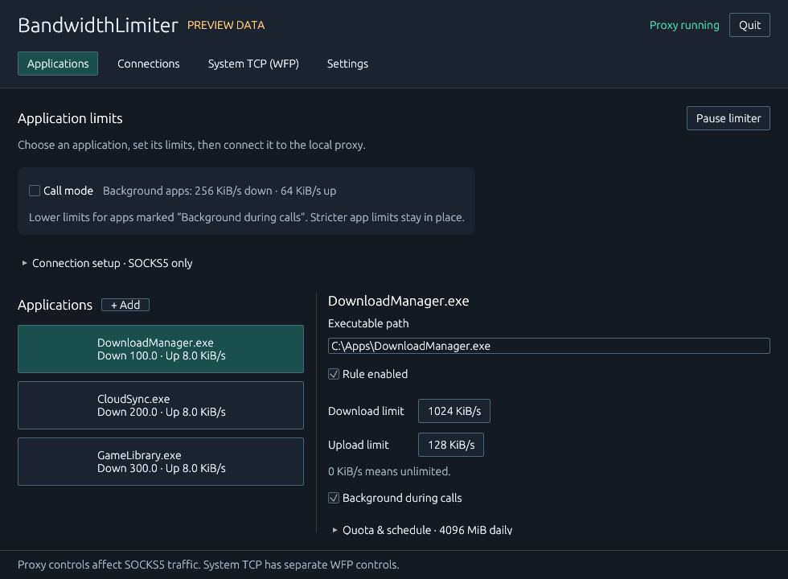
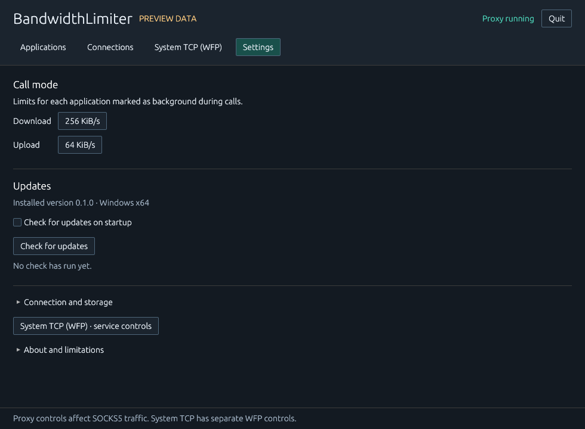
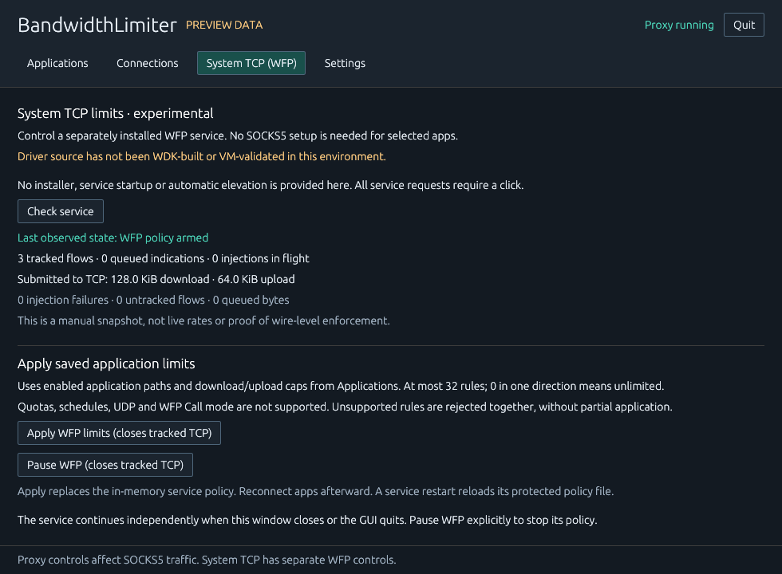

# BandwidthLimiter

A Windows x64 desktop utility for explicit, per-application TCP bandwidth policies and call-friendly presets. Version 0.1.0 is an early implementation with a real SOCKS5 relay and a testable policy engine. It is independent of, and not affiliated with, NetLimiter. The implementation and interface are original.

**Available backend:** the portable GUI's SOCKS5 proxy paces TCP connections explicitly routed through it. Applications must support SOCKS5 themselves; ordinary launch/Save does not change Windows networking. The **System TCP (WFP)** page now controls a separately staged service through local authenticated IPC, and [experimental driver sources](backend/README.md) add upload/download pacing without SOCKS. The GUI and broker build, but the driver has not been WDK-built or validated. No service/driver is installed or automatically started; actual system TCP shaping remains unverified.

## Capabilities

| Area | Implemented behavior | Boundary |
| --- | --- | --- |
| Upload and download caps | Aggregate payload pacing per executable and direction across all its proxy connections | Payload delivery / TCP backpressure, not an adapter-level receive cap |
| Application identity | Windows IP Helper maps the local connecting socket to its PID; a read-only process query resolves its full executable path | Unknown, protected and unmatched processes are refused; paths are not a security boundary |
| Call mode | Caps each enabled application marked **Background during calls**; preserves stricter base caps | Applies only to proxied TCP; no automatic call or microphone detection |
| Daily quota | Combined download + upload budget with partial-chunk reservation and local-date reset | Checkpointed every five seconds and at normal shutdown; crash/power loss can lose the last checkpoint interval |
| Weekly schedules | Selected weekdays, local times, overnight windows and all-day windows | Base caps become unlimited outside the window; call caps and quotas remain active |
| Activity | Successfully forwarded proxy payload bytes and sampled rates; daily reserved bytes | No fabricated rates for direct traffic |
| Windows inventory | Read-only IPv4/IPv6 TCP/UDP endpoints, PID, process path, state | No global per-process byte counters; unavailable identity is shown explicitly |
| Experimental System TCP (WFP) | Manual GUI status, administrator-authorized Apply/Pause, Rust SCM broker and C driver sources with independent per-executable upload/download queues | Driver WDK build and end-to-end VM validation pending; TCP only, no quotas/schedules/Call mode; policy changes close tracked TCP connections |
| Updates | Background startup check with saved opt-out; manual check; download progress; SHA-256 verification; restart/replacement helper | Repository/release may be unpublished; replacement and live network behavior require manual validation |

## Build and package

Requires Windows 10/11 x64, Rust 1.92+ with the `x86_64-pc-windows-msvc` toolchain and existing Visual Studio C++ build tools. No WDK, driver, service or administrator access is required for the explicit proxy. Other platforms are not supported distributions.

```powershell
cargo build --locked -j 2
./scripts/check.ps1
./scripts/package.ps1 -Offline
```

If dependencies have not already been cached, omit `-Offline` when packaging and run `cargo fetch --locked` before the offline checks. Cargo is restricted to two jobs and the repository-local `target` directory. The package script creates `dist/BandwidthLimiter-v0.1.0.exe` and `dist/SHA256SUMS`. It does not launch the executable or publish anything. The Windows release statically links the CRT where supported; all fonts are embedded.

## Use after manual validation

1. In **Applications**, choose **Add application** and enter the full EXE path, or choose **Connections → Refresh connections → Add rule**.
2. Set download/upload caps in **KiB/s** (1024 bytes per second). Open **Quota & schedule** for a combined daily quota in **MiB** or a weekly window. Zero means unlimited. Mark background download apps for Call mode. Use **Save changes** in the persistent unsaved-changes bar.
3. Choose **Start limiter**. In the selected application's own settings, choose SOCKS5, host `127.0.0.1`, port `1088` (or the saved port). **Connection setup** shows the details. The proxy does not autostart on launch.
4. Route a small test transfer through it. Application rows show measured proxy rates; selecting a row shows its configured limits. Toggle **Call mode** to lower background app caps at the next payload operation.
5. With a tray icon available, closing X hides the same window and keeps work active. Click the icon to open its short menu: Open, Start/Pause, Call mode, Settings, Quit. **Pause limiter** or **Quit** closes proxy connections. An independently running WFP service remains active after GUI Quit; use its own Pause action. If tray creation fails, closing X exits instead of leaving an inaccessible process. Native tray/restore behavior remains pending interactive verification.

Only SOCKS5 `CONNECT` is supported. UDP associate, BIND, QUIC, DNS-over-UDP forwarding and transparent capture are not implemented. SOCKS domain names resolve on the proxy's worker, with no TLS interception or payload inspection. Incoming proxy connections use IPv4 loopback; destination connections support IPv4 and IPv6. An application that uses separate downloader/helper executables needs a rule for each actual connecting executable. There are at most 32 concurrent proxy flows. This is a cooperative utility, not a mechanism to prevent an application from bypassing a policy.

Equal schedule start/end times mean all day on the selected weekdays. End times are exclusive. For Sunday 23:00–Monday 01:00, select Sunday with `23:00` to `01:00`. Local clock/timezone changes affect calendar schedules and quota dates; pacing uses a monotonic clock.

For **System TCP (WFP)**, follow the [separate build/staging/VM test instructions](docs/WFP-SETUP.md). The GUI never installs, starts or elevates the backend. **Check service** is a manual snapshot; standard users can read status, and Apply/Pause require an elevated administrator client. Apply uses saved enabled caps as an in-memory policy; restart reloads the protected service JSON. Unsupported enabled quotas/schedules and active Call mode are rejected. Pause/reapply/service stop/lease loss close tracked TCP connections. The experimental receive queue can overflow under fast senders, and whole-indication pacing can cause long delays at low caps. Read the [design limits](docs/WFP-DESIGN.md) before testing. Portable EXE updates do not update the service or driver.

Settings and daily usage live under `%LOCALAPPDATA%/BandwidthLimiter`, separately from the executable. Edits take effect only after a successful save. A corrupt or unsupported settings file is preserved and produces a startup error. A data-directory file lock prevents concurrent workers; a same-session named event requests that the running instance reopen its window. Call mode and the proxy start off each launch. Foreground activation, keyboard traversal and repeated hide/restore cycles still need native validation.

## Updates

**Settings** shows the installed version, **Check for updates**, and the persistent **Check for updates on startup** toggle (on by default). Save the toggle to make it apply on the next launch. Disabled means no startup update request. Startup checks run on one background worker; no-update results and transient errors stay in Settings, while a newer version gets an inline notice.

The planned canonical repository is [siarheisinelnikau/bandwidth-limiter](https://github.com/siarheisinelnikau/bandwidth-limiter). A missing repository/release or HTTP failure is an error, never an up-to-date result. Stable semantic versions and the exact compatible Windows x64 asset name are required. Nothing has been published by this development session.

**Download and install** downloads only after a click, limits the size, and requires a GitHub API SHA-256 digest or a matching `SHA256SUMS` entry. The downloaded file must be a Windows x64 PE executable. **Restart to finish update** prepares a copy of the current executable as a helper, waits for a readiness acknowledgement and normal app exit, preserves a `.previous.exe` backup, atomically replaces the EXE and relaunches it. Data stays in LocalAppData. Errors before replacement preserve the installed EXE; helper errors are written to `updates/last-update-error.txt`. A non-writable installation directory requires a manually managed update; no elevation is requested. SHA-256 from the same release detects corruption; it does not provide independent publisher authentication. Release signing is future work.

## Verification and screenshots

See [verification status](docs/VERIFICATION.md), [architecture](docs/ARCHITECTURE.md), [Windows API constraints](docs/WINDOWS-BACKEND.md), and [draft release notes](docs/RELEASE-v0.1.0.md).

For the new backend see [WFP source status](backend/README.md), [design/lifecycle review](docs/WFP-DESIGN.md), and [manual VM build/install/removal instructions](docs/WFP-SETUP.md). `scripts/build-wfp.ps1` only builds; it does not install or launch anything. Driver/service updates are separate from portable GUI updates.

The interface uses **egui CPU rasterization + softbuffer's Win32 GDI presentation**. eframe, OpenGL and wgpu are removed. Idle rendering is event-driven; hidden/minimized windows skip layout, rasterization and presentation in the host. These are source-level behavior and unit checks, not measured native idle/hidden performance. The full runtime gate remains incomplete because ordinary GUI launches and computer use were not performed.

The images below are real application-generated **client-area renders with clearly marked artificial preview data**, produced by the same UI components and CPU rasterizer without creating a native window. No desktop screenshot, user process inventory or network access was used. They verify static layout, not native title bars, tray clicks, performance or actual shaping.







To reproduce the finite seven-screen capture after packaging:

```powershell
./scripts/render-preview.ps1
```

It uses a fresh output directory, a 25-second external timeout, and the EXE's early `--render-preview ABSOLUTE_DIRECTORY` branch. That branch writes PNGs and exits before normal settings, workers, update checks, instance events or tray initialization. See [design and rendering verification](docs/UI-VERIFICATION.md) for the captured empty/error/125% states and remaining checks. Normal operation can opt into exit-time frame diagnostics with `--diagnostics ABSOLUTE_JSON_PATH`; that mode is intended for later bounded native testing and was not launched here.

Licensed under [MIT](LICENSE). Dependency licenses remain their own; see [third-party notes](docs/THIRD-PARTY.md).
